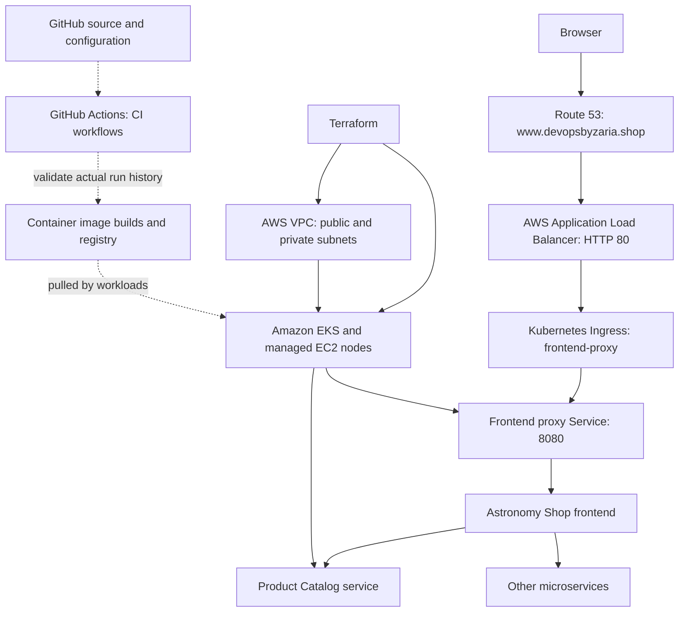

Repository: https://github.com/zariad/ultimate-devops-project-demo
1. Project overview
The Astronomy Shop is a realistic, multi-service e-commerce demonstration application. I use it as the workload for an end-to-end DevOps exercise: learn how an application moves from source code to containers, how cloud infrastructure is defined as code, how a Kubernetes cluster runs containerized services, and how automation supports repeatable delivery.

The goal is not to build a storefront from scratch. It is to understand the platform and delivery lifecycle around an existing application, the kind of collaboration that occurs between developers, testers, and platform/DevOps engineers.
Learning goals
- Read and understand an existing microservices codebase.
- Explain what Docker images package and why containers make deployments consistent.
- Provision AWS networking and Kubernetes infrastructure using reusable Terraform modules.
- Understand Kubernetes Deployments, Pods, Services, and external access.
- Examine how GitHub Actions can automate build, test, image publishing, and manifest updates.
- Practice debugging configuration errors, permissions, secrets, and infrastructure dependencies.
- Describe how observability and GitOps fit into a mature delivery process.
Deployment status (24 October 2026): The Astronomy Shop was successfully accessed through http://www.devopsbyzaria.shop, and HTTP requests to both / and /api/products returned 200 OK after redeployment. This verifies the public entry point and product API at the time of testing; it does not independently verify every checkout flow, GitHub Actions workflow, Argo CD synchronization, or production readiness.
2. Architecture
Infrastructure and deployment model

The public traffic path and Terraform-managed infrastructure have been demonstrated in this deployment. The GitHub Actions → image → deployment chain is an intended automation path and must be demonstrated with actual successful runs before claiming end-to-end CI/CD completion. Argo CD is a possible GitOps extension, not a confirmed current deployment.
Confirmed live workflow
1. Terraform provisions the AWS VPC, subnets, routing, EKS cluster, and managed worker nodes.
2. Kubernetes and Helm run the multi-service Astronomy Shop on EKS.
3. The AWS Load Balancer Controller provisions an internet-facing ALB from the frontend-proxy Ingress.
4. Route 53 resolves www.devopsbyzaria.shop to that ALB.
5. The ALB routes requests to opentelemetry-demo-frontendproxy on port 8080.
6. The frontend API retrieves product data from the Product Catalog service; the public /api/products request returned HTTP 200 OK.
Troubleshooting highlights
- A prior product request returned HTTP 500 because the frontend could not connect to the Product Catalog service on port 8080.
- Rebuilding the EKS environment required re-establishing AWS Load Balancer Controller identity against the new cluster OIDC provider.
- The controller entered CrashLoopBackOff because it could not discover its VPC from instance metadata. Passing the VPC ID explicitly through Helm configuration resolved that particular startup blocker.
- The Route 53 www alias initially pointed to the previous ALB DNS name after the cluster rebuild. Updating it to the new active ALB restored public DNS resolution.
- Testing curl -i http://www.devopsbyzaria.shop/ and curl -i http://www.devopsbyzaria.shop/api/products returned HTTP 200 OK.
3. Technologies and why they matter
Tool	Role in project	Practical value
Git / GitHub	Source control and repository hosting	Tracks changes and supports collaboration
Terraform	Infrastructure as Code	Repeatable, reviewable cloud provisioning
AWS VPC	Networking foundation	Separates network resources into public and private subnets
Amazon EKS	Managed Kubernetes control plane	Provides a managed environment for Kubernetes workloads
EC2 managed node group	Kubernetes worker compute	Runs application Pods; configured via EKS node groups
IAM	AWS permissions for EKS/node roles	Controls what infrastructure components may do
Amazon S3	Terraform state backend configured in eks/main.tf	Stores remote state when correctly bootstrapped
DynamoDB	State-lock table referenced in eks/main.tf	Listed in configuration; verify table/backend compatibility for the installed Terraform version
Docker / Docker Compose	Container images and local service composition	Reproducible application runtime and local experimentation
Kubernetes	Deployment and service orchestration	Self-healing and desired-state management concepts
GitHub Actions	Workflow automation in .github/workflows/	CI tasks and potential deployment integration
OpenTelemetry	Distributed observability in upstream app	Traces, metrics, and logs across services
Helm	Installed the Astronomy Shop and AWS Load Balancer Controller	Packages related Kubernetes resources
AWS Load Balancer Controller	Creates ALBs from Ingress resources	Exposes services publicly
Route 53	Hosted zone and alias for www.devopsbyzaria.shop	Public DNS routing

Argo CD: The earlier environment included Argo CD, but its installation and GitOps synchronization on the rebuilt EKS cluster have not yet been verified. Do not present GitOps automation as complete unless a healthy Argo CD Application and actual sync are demonstrated.

4. Verified Terraform configuration
The files described below are publicly visible in this fork:
- [`eks/main.tf`](eks/main.tf) — AWS provider pinned to ~> 6.0, provider region us-east-1, S3 backend settings, and VPC/EKS module calls.
- [`eks/variables.tf`](eks/variables.tf) — VPC CIDR, subnets, availability zones, EKS cluster name/version, and node-group sizing.
- [`eks/outputs.tf`](eks/outputs.tf) — cluster endpoint, cluster name, and VPC ID outputs.
- [`eks/modules/vpc/main.tf`](eks/modules/vpc/main.tf) — VPC, three public subnets, three private subnets, internet gateway, three NAT gateways and routing resources.
- [`eks/modules/eks/main.tf`](eks/modules/eks/main.tf) — IAM roles/policy attachments, EKS cluster and managed node group.
Default settings defined in eks/variables.tf
Setting	Value in repository
AWS region	us-east-1
VPC range	10.0.0.0/16
Availability zones	us-east-1a, us-east-1b, us-east-1c
Private subnets	10.0.1.0/24, 10.0.2.0/24, 10.0.3.0/24
Public subnets	10.0.4.0/24, 10.0.5.0/24, 10.0.6.0/24
EKS cluster name	my-eks-cluster
Kubernetes version requested	1.31 (check current EKS availability/support before applying)
Managed node group	general
Node EC2 instance type	t3.medium
Node purchase model	ON_DEMAND
Desired / minimum / maximum nodes	2 / 1 / 4

Network design: EKS and managed node-group configuration point to the private subnet IDs output by the VPC module. Public subnets are also configured for public-facing infrastructure. NAT gateways allow private-subnet workloads to initiate outbound connections without giving the instances direct public IPs.

Potential improvement: There is one NAT gateway per public subnet, but each private subnet routes to the NAT gateway at the same list index. This is a relatively expensive learning setup: account for NAT gateway hourly and data-processing charges, EKS cluster charges, EC2 instance costs, and other resources.
5. Repository structure
ultimate-devops-project-demo/
├── .github/workflows/       # GitHub Actions workflow definitions
├── eks/                     # Terraform: AWS networking + EKS
│   ├── main.tf
│   ├── variables.tf
│   ├── outputs.tf
│   └── modules/
│       ├── vpc/             # VPC networking resources
│       └── eks/             # EKS and IAM resources
├── kubernetes/              # Kubernetes deployment configuration
├── src/                     # Astronomy Shop services
├── test/                    # Application tests
├── internal/tools/          # Supporting tools
├── pb/                      # Protocol buffer definitions
├── docker-compose.yml       # Local multi-container runtime
├── docker-compose.minimal.yml
├── Makefile
├── package.json
└── README.md
Folders may contain additional upstream files; this summary focuses on the primary DevOps surfaces.
6. Reproducing and exploring the project
Prerequisites
- Git, Docker and Docker Compose
- Terraform CLI compatible with the repository configuration
- AWS account, AWS CLI credentials, and appropriate IAM permissions (for AWS deployment only)
- kubectl (for Kubernetes cluster access)
- Sufficient AWS budget and permission to create chargeable resources
Clone and explore
git clone https://github.com/zariad/ultimate-devops-project-demo.git
cd ultimate-devops-project-demo
ls
Local application using Docker Compose
docker compose config           # Validate Compose configuration
docker compose up --build -d   # Build/start services (resource intensive)
docker compose ps              # Check containers
docker compose logs --tail=50 # Inspect recent logs
docker compose down            # Stop and remove local containers
Check service port mappings in docker-compose.yml rather than assuming a particular browser port. The full demo can require substantial CPU and RAM.
Terraform review (do not apply until prerequisites are ready)
cd eks
terraform fmt -check -recursive
terraform init
terraform validate
terraform plan
Bootstrap warning: The root Terraform configuration declares an S3 backend using an S3 bucket and a DynamoDB lock table. Backend resources must exist before terraform init can successfully use them. The same configuration also declares an aws_s3_bucket resource for that bucket; Terraform cannot bootstrap its own remote backend from an empty environment in one step. Create/bootstrap state storage separately or use a temporary local-backend workflow and then migrate state. Confirm the DynamoDB locking behavior against the installed Terraform version; recent Terraform versions support S3 lockfiles as an alternative.

Before deployment: Review EKS/Kubernetes version support, IAM permissions, state backend, AWS service quotas, security settings, and costs. Do not run terraform apply blindly against a personal or production account.
If an EKS cluster has actually been created
aws eks update-kubeconfig --region us-east-1 --name my-eks-cluster
kubectl cluster-info
kubectl get nodes
kubectl get pods -A
kubectl get svc -A
These commands inspect the deployed cluster; they do not create one. On October 24, 2026, public storefront and Product Catalog requests were verified as working.
Inspecting automation
1. Open .github/workflows/ to review workflow names, triggers, jobs, and secrets references.
2. Open GitHub's Actions tab and choose a workflow run.
3. Check which jobs passed or failed and confirm where any published image was sent.
4. In kubernetes/, inspect the exact image tags and service definitions referenced by the workflow.
Do not expose real secrets, cloud credentials, .env values, or tokens in screen recordings.
7. CI/CD explained in plain English
A representative software delivery flow is:
Code changes → Pull request / push → CI checks → Docker image build
→ Image registry → Deployment configuration update → Kubernetes rollout
→ Health checks / monitoring
The intent of CI is to automatically verify a change. CD then delivers a verified version to an environment through a consistent, repeatable process. This is a conceptual lifecycle, not a claim that each step currently runs in this repository. Use actual GitHub Actions YAML and run logs to establish which stages exist and work.
8. Challenges and lessons learned
This project helps connect multiple pieces that are often taught separately:
- Terraform vs. Docker: Terraform provisions infrastructure; Docker packages a service. Infrastructure existing does not mean an application has been built or deployed.
- Docker vs. Kubernetes: Docker images package applications; Kubernetes coordinates and maintains those containers across a cluster.
- CI vs. CD: Passing tests/building an image is different from deploying a new version successfully.
- GitHub repository vs. local workspace: A remote repository can be cloned locally and edited in VS Code; GitHub's browser-based editor is a different working environment.
- Configuration vs. live state: YAML/Terraform code alone does not prove that AWS resources or pods are healthy.
- Troubleshooting: Version incompatibilities, backend dependencies, permissions, secrets, container builds, and workload networking must be handled at different layers.
9. Validation checklist
Before calling the project fully deployed, collect evidence for the following:
- [ ] Terraform backend initialized successfully
- [ ] terraform validate and terraform plan succeed
- [x] AWS VPC, subnets and EKS resources provisioned
- [x] kubectl get nodes shows Ready workers
- [ ] Application Deployments/Pods reach Ready state
- [x] Services/Ingress route to the application
- [ ] A GitHub Actions workflow completes its intended jobs
- [ ] The expected container image is published and referenced
- [ ] A code or configuration change propagates as intended
- [x] Public application access and product API demonstrated (/ and /api/products returned HTTP 200)
- [ ] Observability dashboards demonstrated
- [ ] AWS resources destroyed when no longer needed
10. Future improvements
- Replace the hard-coded backend bucket and cluster settings with an environment-specific bootstrap strategy.
- Revisit backend state locking and supported EKS versions.
- Add Terraform formatting, validation, and security scans to CI.
- Introduce reusable image tags tied to commit SHA and image vulnerability scanning.
- Add Kubernetes resource requests/limits, probes, and controlled rollout practices.
- Maintain Helm-based deployment configuration, and re-establish/verify Argo CD for GitOps-based CD.
- Capture dashboard screenshots, sample workflow logs, and an actual end-to-end release demonstration.
- Add cost alerts, least-privilege IAM, and a cleanup procedure.
11. Acknowledgments and attribution
This is a hands-on educational implementation based on an existing open-source application and tutorial ecosystem, not an originally authored e-commerce app. The Astronomy Shop comes from the OpenTelemetry community, and this repository is forked through iam-veeramalla/ultimate-devops-project-demo. Refer to the included LICENSE for licensing details. Credit for the application belongs to the original contributors; my focus is on practicing and documenting DevOps infrastructure and delivery workflows.
Presenter: Zaria | Focus: Entry-level Cloud/DevOps engineering portfolio | Status: Live storefront and Product Catalog API verified October 24, 2026; CI/CD and GitOps integration need separate validation.
